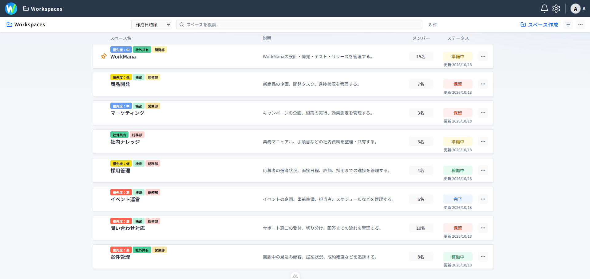
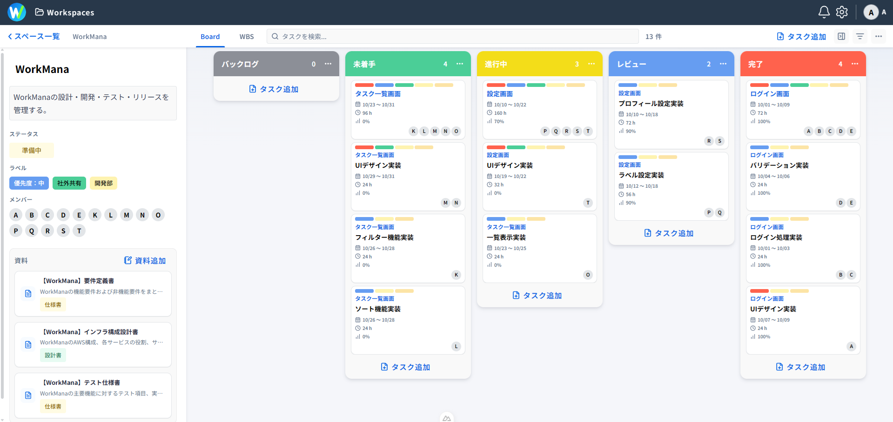
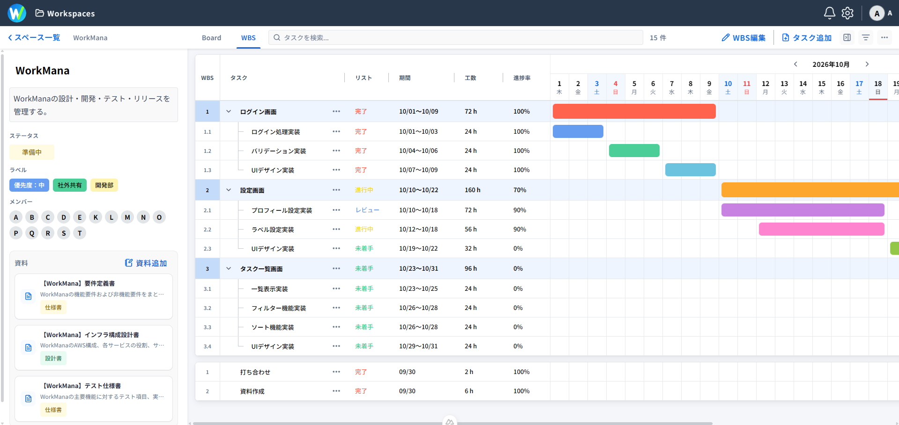
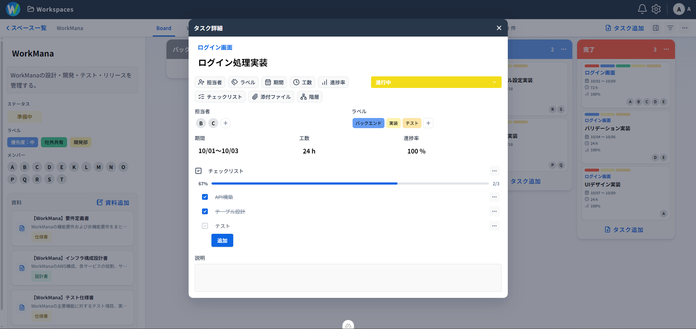
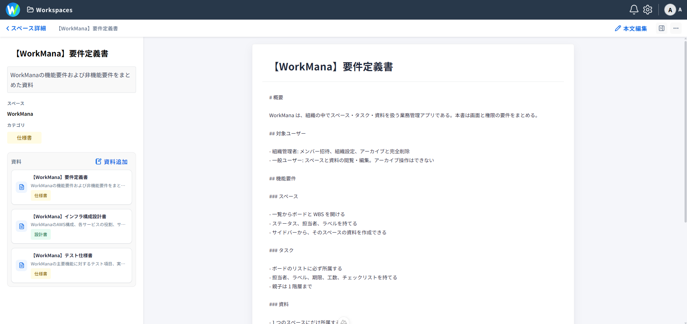
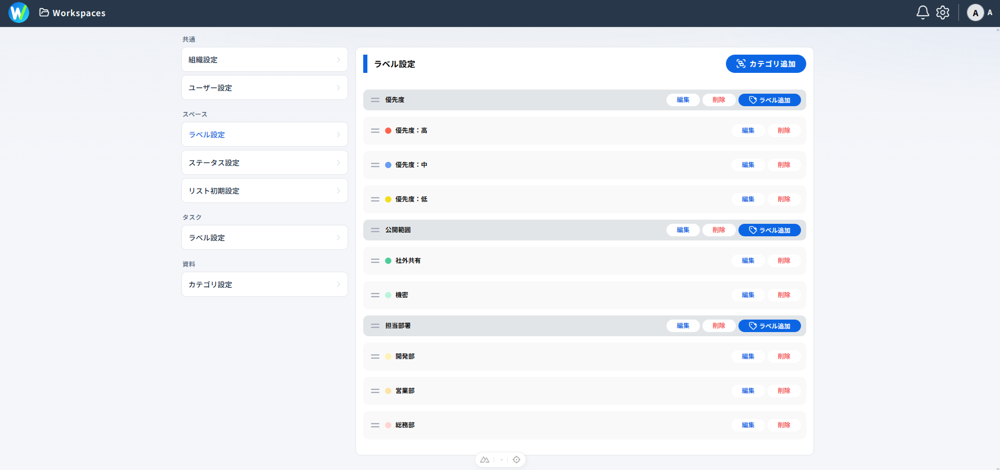
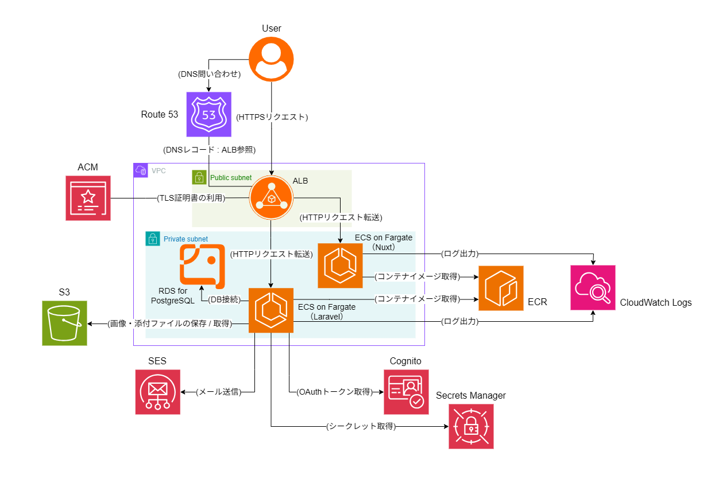

# WorkMana

現在、AWSの運用コストを考慮し、デモ環境の公開を一時停止しています。  
アプリケーションの画面や機能については、本リポジトリのスクリーンショットをご覧ください。

## 目次

- [概要](#概要)
- [特徴](#特徴)
- [スクリーンショット](#スクリーンショット)
- [主要機能](#主要機能)
- [技術スタック](#技術スタック)
- [AWSアーキテクチャ](#AWSアーキテクチャ)
- [TerraformによるIaC化](#TerraformによるIaC化)
- [CI/CDパイプライン](#CI/CDパイプライン)
- [セットアップ](#セットアップ)
- [テスト](#テスト)
- [ドキュメント](#ドキュメント)

---

## 概要

**WorkMana**は、チームのタスク管理・資料共有を一元化する業務管理アプリです。ドメインは [workmanager.jp](https://workmanager.jp) です。
組織ごとにデータを管理するマルチテナント構成を採用し、ユーザー・権限・スペースを管理できます。
スペース内では、Board（カンバン形式）とWBS（階層形式：ガントチャート付き）によるタスク管理に加え、資料やラベルの管理にも対応しています。
フロントエンドとバックエンドを分離した構成で、認証には `Amazon Cognito`、リアルタイム同期には `Laravel Reverb` を利用しています。

---

## 特徴

- **組織単位のマルチテナント** — 組織・ユーザー・招待・設定を組織ごとに分離
- **Board と WBS** — 同一スペース内で、Board リストの並び替えとガントチャート付き WBS ビューを利用可能
- **資料管理** — スペース配下の資料の本文編集と、カテゴリによる分類に対応
- **セッションベース認証** — Amazon Cognito の認可コードフロー（PKCE）を採用し、JWT はブラウザに保存せず、HttpOnly Cookie
- **リアルタイム同期** — Laravel Reverb を利用し、組織のスペース・タスク・資料・設定・ユーザーの変更を他クライアントに反映
- **添付ファイルの非公開管理** — タスクの添付ファイルを非公開ディスクに保存し、認証が必要なダウンロード経由でのみ取得可能（直リンク不可）

---

## スクリーンショット

### スペース一覧



### タスク一覧：Board



### タスク一覧：WBS



### タスク詳細



### 資料本文



### 設定



---

## 主要機能

### 組織管理

- **組織管理**：組織の作成・切り換え・削除
- **組織設定**：組織名および組織アイコン画像の編集
- **権限管理**：「組織の削除」「組織設定の編集」は管理者のみ可能

### ユーザー管理

- **ユーザー管理**：組織内の他ユーザーの役割変更・削除
- **ユーザー招待**：メールによる組織への招待・取消、新規ユーザーの登録、既存ユーザーの参加
- **プロフィール設定**：自分のユーザー名およびアバター画像の編集
- **認証**：アカウント登録、ログイン、ログアウト
- **権限管理**：「他ユーザーの役割変更・削除」「ユーザーの招待・取消」は管理者のみ可能

### スペース管理

- **スペース管理**：スペースの作成・編集・ピン留め・検索・並び替え・絞り込み・アーカイブ
- **アーカイブ管理**：アーカイブ済みのスペースの復元・削除
- **スペース詳細**
  - **メンバー**：組織内の全ユーザーから複数選択
  - **スペースラベル**：設定済みのスペースラベルから複数選択
  - **ステータス**：設定済みのステータスから単数選択
  - **説明**：テキストの入力
- **設定**：スペースに紐づける項目の設定
  - **スペースラベル設定**：スペース用のラベルおよびラベルカテゴリの追加・編集・並び替え・削除
  - **ステータス設定**：ステータスの追加・編集・並び替え・削除
- **権限管理**：「スペースのアーカイブ・復元・削除」「スペースラベル設定・ステータス設定」は管理者のみ可能

### タスク管理

- **タスク管理**：タスクの追加・編集・検索・並び替え・絞り込み・アーカイブ
- **アーカイブ管理**：アーカイブ済みのタスクの復元・削除
- **タスク詳細**
  - **親タスク**：スペース内の親タスクから単数選択（親タスクの追加時は選択不可）
  - **担当者**：スペース内のメンバーから複数選択
  - **タスクラベル**：設定済みのタスクラベルから複数選択
  - **期間**：開始日および終了日の選択
  - **工数**：数値の入力（単位：h）
  - **進捗率**：数値の入力（単位：%）
  - **リスト**：配置するリストの単数選択
  - **チェックリスト**：チェックリストの追加・編集・折り畳み・削除、項目の追加・編集・チェック・削除
  - **添付ファイル**：添付ファイルの追加・プレビュー・ダウンロード・削除
  - **説明**：テキストの入力
- **設定**：タスクに紐づける項目およびリストの設定
  - **タスクラベル設定**：タスク用のラベルおよびラベルカテゴリの追加・編集・並び替え・削除
  - **リスト初期設定**：スペース作成時のリストの追加・編集・並び替え・削除
- **表示形式**：Board / WBS の切り換え
- **Board**：カンバン形式によるタスク管理
  - **リスト管理**：リストの追加・編集・並び替え・削除
- **WBS**：階層形式によるタスク管理
  - **WBS編集**：セル選択によるWBSの編集
  - **ガントチャート**：タスクの期間表示
  - **表示項目設定**：表示項目の選択（タスク名は固定）
- **権限管理**：「タスクのアーカイブ・復元・削除」「タスクラベル設定・リスト初期設定」は管理者のみ可能

### 資料管理

- **資料管理**：資料の追加・編集・アーカイブ
- **アーカイブ管理**：アーカイブ済みの資料の復元・削除
- **資料詳細**
  - **カテゴリ**：設定済みのカテゴリから単数選択
  - **説明**：テキストの入力
  - **本文**：テキストの入力
- **設定**：資料に紐づける項目の設定
  - **カテゴリ設定**：カテゴリの追加・編集・並び替え・削除
- **権限管理**：「資料のアーカイブ・復元・削除」「カテゴリ設定」は管理者のみ可能

### その他

- **通知**：通知選択による関連画面への遷移および既読化
- **リアルタイム同期**：各種データの更新を他ユーザー画面にもリアルタイムで反映

---

## 技術スタック

| 分類 | 技術 |
|------|------|
| フロントエンド | Nuxt 4 / Vue 3 / TypeScript / SCSS |
| バックエンド | Laravel 13 / PHP 8.3 |
| データベース | Amazon RDS for PostgreSQL |
| 認証 | Amazon Cognito |
| リアルタイム同期 | Laravel Reverb / Laravel Echo / Pusher JS |
| 実行環境 | Node.js 22 / nginx / PHP-FPM |
| コンテナ | Docker |
| コンテナレジストリ | Amazon ECR |
| コンピューティング | Amazon ECS / AWS Fargate |
| ネットワーク | Amazon VPC / Application Load Balancer |
| IaC | Terraform |
| CI / CD | GitHub Actions |
| DNS | Amazon Route 53 |
| 証明書 | AWS Certificate Manager |
| ストレージ | Amazon S3 |
| セキュリティ | AWS IAM / AWS Secrets Manager |
| ログ管理 | Amazon CloudWatch Logs |
| メール配信 | Amazon SES |

---

## AWSアーキテクチャ



### 設計上のポイント

<table>
  <thead>
    <tr>
      <th>分類</th>
      <th>設計内容</th>
      <th>設計理由</th>
    </tr>
  </thead>
  <tbody>
    <tr>
      <td rowspan="3">ネットワーク設計</td>
      <td>VPC 内にパブリックサブネットと<br>プライベートサブネットを配置</td>
      <td>インターネットからのアクセス経路と<br>内部リソースへの通信経路を分離するため</td>
    </tr>
    <tr>
      <td>パブリックサブネットとプライベートサブネットを<br>2つの AZ に分散</td>
      <td>単一 AZ の障害による影響を軽減するため</td>
    </tr>
    <tr>
      <td>ALB で HTTPS 通信を受け付け、<br>HTTP 通信は HTTPS にリダイレクト</td>
      <td>通信を暗号化して<br>安全にアプリケーションへアクセスできるようにするため</td>
    </tr>
    <tr>
      <td rowspan="3">アプリケーション構成</td>
      <td>Nuxt（フロントエンド）と<br>Laravel（バックエンド）を分離</td>
      <td>フロントエンドとバックエンドを<br>独立して管理・デプロイできるようにするため</td>
    </tr>
    <tr>
      <td>ECS Fargate でコンテナを実行</td>
      <td>EC2 インスタンスの管理負担を抑えながら<br>コンテナを実行するため</td>
    </tr>
    <tr>
      <td>ECR でコンテナイメージを管理</td>
      <td>コンテナイメージを一元管理して<br>ECS へのデプロイに利用するため</td>
    </tr>
    <tr>
      <td rowspan="2">データ管理</td>
      <td>RDS for PostgreSQL によるデータ管理</td>
      <td>マネージドサービスを利用して<br>データベースの運用負担を軽減するため</td>
    </tr>
    <tr>
      <td>S3 による画像・添付ファイルの管理</td>
      <td>画像および添付ファイルを<br>データベースとは分離して管理するため</td>
    </tr>
    <tr>
      <td rowspan="2">認証・認可</td>
      <td>Amazon Cognito によるユーザー認証</td>
      <td>ユーザー認証をマネージドサービスに委任して<br>認証機能の実装・運用負担を軽減するため</td>
    </tr>
    <tr>
      <td>Laravel による組織・メンバーシップに基づく認可</td>
      <td>アプリケーション固有の権限や<br>組織単位のアクセス制御を実現するため</td>
    </tr>
    <tr>
      <td rowspan="5">セキュリティ</td>
      <td>HTTPS 通信による<br>インターネット経由の通信暗号化</td>
      <td>通信内容の盗聴や改ざんを防ぐため</td>
    </tr>
    <tr>
      <td>IAM ロールによる<br>AWS リソースへのアクセス制御</td>
      <td>必要な AWS リソースへのアクセス権限を付与して<br>認証情報を直接管理する必要をなくすため</td>
    </tr>
    <tr>
      <td>Secrets Manager によるシークレット管理</td>
      <td>認証情報などの機密情報を安全に管理するため</td>
    </tr>
    <tr>
      <td>S3 のパブリックアクセスブロック</td>
      <td>保存したファイルが意図せず外部公開されることを防ぐため</td>
    </tr>
    <tr>
      <td>SSE-S3 による S3 保存データの暗号化</td>
      <td>保存データを暗号化して保護するため</td>
    </tr>
    <tr>
      <td>リアルタイム通信</td>
      <td>Laravel Reverb による WebSocket 通信</td>
      <td>ユーザー間で更新情報をリアルタイムに共有するため</td>
    </tr>
    <tr>
      <td rowspan="3">可用性設計</td>
      <td>ALB を2つの AZ にまたがるサブネットに配置</td>
      <td>単一 AZ の障害による ALB への影響を軽減するため</td>
    </tr>
    <tr>
      <td>ECS はフロントエンド・バックエンドともに<br>各1タスクで運用</td>
      <td>個人開発の規模に合わせて構成をシンプルに保ち<br>運用・コストの負担を抑えるため</td>
    </tr>
    <tr>
      <td>RDS はシングル AZ 構成</td>
      <td>マルチ AZ 構成と比較してコストを抑えるため</td>
    </tr>
    <tr>
      <td rowspan="3">監視・データ保護</td>
      <td>CloudWatch Logs による<br>アプリケーションログの管理</td>
      <td>アプリケーションの動作状況やエラーを記録して<br>障害調査に利用するため</td>
    </tr>
    <tr>
      <td>RDS の自動バックアップ</td>
      <td>データベースの障害や誤操作に備え<br>バックアップから復元できるようにするため</td>
    </tr>
    <tr>
      <td>S3 のバージョニング</td>
      <td>画像および添付ファイルの上書き・削除が発生した場合に<br>過去のバージョンを復元できるようにするため</td>
    </tr>
  </tbody>
</table>

### セキュリティ設計

<table>
  <thead>
    <tr>
      <th>分類</th>
      <th>内容</th>
    </tr>
  </thead>
  <tbody>
    <tr>
      <td rowspan="5">認証・セッション管理</td>
      <td>Amazon Cognito によるユーザー認証</td>
    </tr>
    <tr><td>Authorization Code Flow with PKCE による認証フローの保護</td></tr>
    <tr><td>ID トークンの署名・クレーム検証</td></tr>
    <tr><td>HttpOnly Cookie を利用したセッション管理</td></tr>
    <tr><td>ログアウト時のトークン・セッション無効化</td></tr>
    <tr>
      <td rowspan="4">認可・マルチテナント分離</td>
      <td>組織への所属確認に基づくアクセス制御</td>
    </tr>
    <tr><td>組織およびスペース単位でのリソースアクセス制御</td></tr>
    <tr><td>担当者・ラベル・親子タスクなどの関連データの整合性検証</td></tr>
    <tr><td>管理操作に対する権限確認</td></tr>
    <tr>
      <td rowspan="2">通信・本番設定の保護</td>
      <td>HTTPS・Cookie・CORS などの本番環境向け設定の検証</td>
    </tr>
    <tr><td>本番環境での認証バイパス無効化チェック</td></tr>
    <tr>
      <td rowspan="4">ファイル保護</td>
      <td>Amazon S3 でのファイル保存</td>
    </tr>
    <tr><td>アクセス権限の検証</td></tr>
    <tr><td>アップロード時のファイルサイズ・拡張子の制限</td></tr>
    <tr><td>ダウンロード時のレスポンスヘッダーによる保護</td></tr>
  </tbody>
</table>

## Terraform による IaC 化

Terraform を使用して AWS リソースをコード化し、インフラ構成をコードで管理できるようにしています。

IaC 化により、インフラ構成の変更履歴を管理できるほか、コードに基づいた環境の再構築が可能になります。

## CI/CD パイプライン

GitHub Actions を使用して、テスト・ビルド・Docker イメージの作成を自動化しています。

ECR へのコンテナイメージの登録から ECS へのデプロイまでを含む CI/CD パイプラインを構築しています。

これにより、アプリケーションの更新からデプロイまでの作業を自動化し、手動作業の削減とデプロイ手順の標準化を図っています。

---

## セットアップ

### 前提環境

- PHP 8.3 以上
- Composer 2.x
- Node.js 22.12 以上
- PostgreSQL
- npm

### ローカル環境の構築

#### リポジトリ取得

```bash
git clone git@github.com:ryuse-yanagi/workmana.git
cd workmana
```

#### バックエンド設定

```bash
cd backend
cp .env.example .env
composer install
php artisan key:generate
createdb workmana
php artisan migrate
php artisan storage:link
php artisan db:seed
```

> `backend/.env` でデータベース接続情報やローカル認証用設定などを環境に合わせる。  
> `DB_DATABASE` が `workmana` 以外の場合は、`createdb` のデータベース名も合わせる。

#### フロントエンド設定

```bash
cd frontend
cp .env.example .env
npm install
```

> Reverb を使う場合は `NUXT_PUBLIC_REVERB_*` をバックエンド側の設定に合わせる。

### 開発サーバーの起動

以下をそれぞれ別のターミナルで起動します。

#### バックエンド

```bash
cd backend
php artisan serve
```

> 既定 URL：`http://127.0.0.1:8000`

#### フロントエンド

```bash
cd frontend
npm run dev
```

> 既定 URL：`http://localhost:3000`

#### リアルタイム同期

```bash
cd backend
php artisan reverb:start
```

> 既定 WebSocket URL：`ws://127.0.0.1:8080`  
> Reverb が別のプロセスや環境によってすでに起動している場合は手動での起動は不要

---

## テスト

```bash
cd backend
php artisan test
```

## ドキュメント

詳細な仕様や設計判断は `_docs/README.md` を参照してください。
